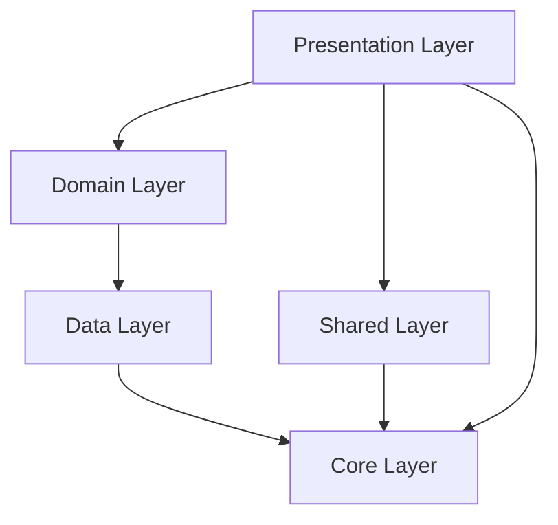
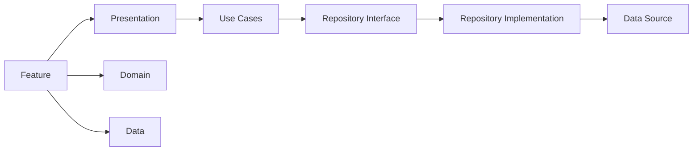
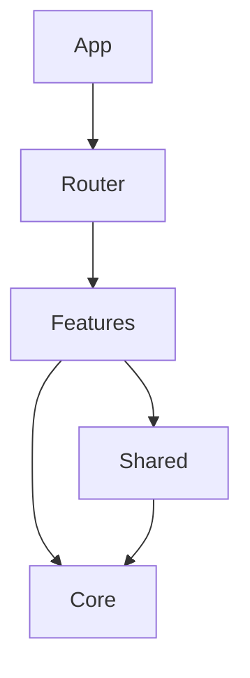

# TrackPense Target Architecture Design

**Date:** July 27, 2026  
**Designer:** Cascade AI  
**Project:** TrackPense v1.1.1

---

## Overview

This document describes the target architecture for TrackPense after refactoring to a feature-based Clean Architecture. The design prioritizes separation of concerns, testability, maintainability, and scalability.

---

## Architecture Principles

1. **Feature-Based Organization:** Each feature is self-contained with its own layers
2. **Clean Architecture:** Clear separation between presentation, domain, and data layers
3. **Dependency Inversion:** High-level modules don't depend on low-level modules
4. **Single Responsibility:** Each class has one reason to change
5. **Interface Segregation:** Small, focused interfaces
6. **Open/Closed:** Open for extension, closed for modification
7. **Testability:** All layers can be tested in isolation

---

## Target Folder Structure

```
lib/
├── app/
│   ├── app.dart
│   ├── router.dart
│   ├── theme/
│   │   ├── app_theme.dart
│   │   ├── app_colors.dart
│   │   ├── app_text_theme.dart
│   │   └── dark_theme.dart
│   ├── localization/
│   │   ├── app_localizations.dart
│   │   └── strings/
│   │       └── en.dart
│   ├── constants/
│   │   ├── app_constants.dart
│   │   ├── route_constants.dart
│   │   └── storage_constants.dart
│   └── dependency_injection.dart
│
├── core/
│   ├── error/
│   │   ├── failures.dart
│   │   ├── exceptions.dart
│   │   └── error_handler.dart
│   ├── database/
│   │   ├── database.dart
│   │   ├── database.g.dart
│   │   ├── migrations/
│   │   │   ├── migration_v1_to_v2.dart
│   │   │   └── migration_strategy.dart
│   │   └── tables/
│   │       ├── payment_table.dart
│   │       ├── category_table.dart
│   │       ├── account_table.dart
│   │       ├── budget_table.dart
│   │       └── attachment_table.dart
│   ├── storage/
│   │   ├── storage_service.dart
│   │   ├── secure_storage_service.dart
│   │   └── preferences_service.dart
│   ├── network/
│   │   ├── network_info.dart
│   │   └── api_client.dart
│   ├── services/
│   │   ├── notification_service.dart
│   │   ├── analytics_service.dart
│   │   └── logging_service.dart
│   ├── utils/
│   │   ├── validators/
│   │   │   ├── amount_validator.dart
│   │   │   ├── date_validator.dart
│   │   │   └── description_validator.dart
│   │   ├── formatters/
│   │   │   ├── currency_formatter.dart
│   │   │   ├── date_formatter.dart
│   │   │   └── decimal_input_formatter.dart
│   │   └── helpers/
│   │       ├── date_helper.dart
│   │       └── currency_helper.dart
│   ├── extensions/
│   │   ├── color_extensions.dart
│   │   ├── datetime_extensions.dart
│   │   ├── double_extensions.dart
│   │   ├── string_extensions.dart
│   │   └── context_extensions.dart
│   ├── widgets/
│   │   ├── common/
│   │   │   ├── buttons/
│   │   │   │   ├── primary_button.dart
│   │   │   │   ├── secondary_button.dart
│   │   │   │   └── icon_button.dart
│   │   │   ├── cards/
│   │   │   │   ├── app_card.dart
│   │   │   │   └── shimmer_card.dart
│   │   │   ├── inputs/
│   │   │   │   ├── app_text_field.dart
│   │   │   │   ├── app_dropdown.dart
│   │   │   │   └── app_date_picker.dart
│   │   │   ├── loading/
│   │   │   │   ├── loading_overlay.dart
│   │   │   │   ├── loading_indicator.dart
│   │   │   │   └── shimmer_loading.dart
│   │   │   ├── feedback/
│   │   │   │   ├── error_widget.dart
│   │   │   │   ├── empty_state_widget.dart
│   │   │   │   └── success_widget.dart
│   │   │   └── dialogs/
│   │   │       ├── confirmation_dialog.dart
│   │   │       ├── error_dialog.dart
│   │   │       └── info_dialog.dart
│   │   └── layout/
│   │       ├── responsive_builder.dart
│   │       ├── screen_layout.dart
│   │       └── scroll_layout.dart
│   ├── theme/
│   │   ├── app_colors.dart
│   │   ├── app_spacing.dart
│   │   ├── app_typography.dart
│   │   └── app_border_radius.dart
│   ├── navigation/
│   │   ├── app_router.dart
│   │   ├── route_guard.dart
│   │   └── navigation_service.dart
│   ├── logging/
│   │   ├── logger.dart
│   │   └── log_level.dart
│   ├── permissions/
│   │   ├── permission_handler.dart
│   │   └── permission_type.dart
│   ├── config/
│   │   ├── app_config.dart
│   │   ├── env_config.dart
│   │   └── feature_flags.dart
│   └── di/
│       ├── core_providers.dart
│       └── service_providers.dart
│
├── features/
│   ├── dashboard/
│   │   ├── presentation/
│   │   │   ├── pages/
│   │   │   │   └── dashboard_page.dart
│   │   │   ├── widgets/
│   │   │   │   ├── summary_card.dart
│   │   │   │   ├── recent_transactions_widget.dart
│   │   │   │   └── quick_actions_widget.dart
│   │   │   ├── providers/
│   │   │   │   └── dashboard_provider.dart
│   │   │   └── controllers/
│   │   │       └── dashboard_controller.dart
│   │   ├── domain/
│   │   │   ├── entities/
│   │   │   │   └── dashboard_summary.dart
│   │   │   ├── repositories/
│   │   │   │   └── dashboard_repository.dart
│   │   │   └── usecases/
│   │   │       ├── get_dashboard_summary.dart
│   │   │       └── get_recent_transactions.dart
│   │   └── data/
│   │       ├── datasources/
│   │       │   └── dashboard_local_datasource.dart
│   │       ├── models/
│   │       │   └── dashboard_summary_model.dart
│   │       └── repositories/
│   │           └── dashboard_repository_impl.dart
│   │
│   ├── transactions/
│   │   ├── presentation/
│   │   │   ├── pages/
│   │   │   │   ├── transactions_list_page.dart
│   │   │   │   ├── transaction_detail_page.dart
│   │   │   │   └── transaction_form_page.dart
│   │   │   ├── widgets/
│   │   │   │   ├── transaction_card.dart
│   │   │   │   ├── transaction_filter_chip.dart
│   │   │   │   ├── transaction_search_bar.dart
│   │   │   │   └── amount_input_widget.dart
│   │   │   ├── providers/
│   │   │   │   ├── transaction_list_provider.dart
│   │   │   │   ├── transaction_form_provider.dart
│   │   │   │   └── transaction_detail_provider.dart
│   │   │   └── controllers/
│   │   │       ├── transaction_list_controller.dart
│   │   │       ├── transaction_form_controller.dart
│   │   │       └── transaction_detail_controller.dart
│   │   ├── domain/
│   │   │   ├── entities/
│   │   │   │   ├── transaction.dart
│   │   │   │   └── transaction_filter.dart
│   │   │   ├── repositories/
│   │   │   │   └── transaction_repository.dart
│   │   │   ├── usecases/
│   │   │   │   ├── get_transactions.dart
│   │   │   │   ├── get_transaction_by_id.dart
│   │   │   │   ├── create_transaction.dart
│   │   │   │   ├── update_transaction.dart
│   │   │   │   ├── delete_transaction.dart
│   │   │   │   └── search_transactions.dart
│   │   │   └── value_objects/
│   │   │       ├── amount.dart
│   │   │       ├── description.dart
│   │   │       └── transaction_date.dart
│   │   └── data/
│   │       ├── datasources/
│   │       │   ├── transaction_local_datasource.dart
│   │       │   └── transaction_remote_datasource.dart
│   │       ├── models/
│   │       │   ├── transaction_model.dart
│   │       │   └── transaction_filter_model.dart
│   │       ├── mappers/
│   │       │   ├── transaction_mapper.dart
│   │       │   └── transaction_filter_mapper.dart
│   │       └── repositories/
│   │           └── transaction_repository_impl.dart
│   │
│   ├── accounts/
│   │   ├── presentation/
│   │   │   ├── pages/
│   │   │   │   ├── accounts_list_page.dart
│   │   │   │   └── account_form_page.dart
│   │   │   ├── widgets/
│   │   │   │   ├── account_card.dart
│   │   │   │   └── account_balance_widget.dart
│   │   │   ├── providers/
│   │   │   │   └── account_provider.dart
│   │   │   └── controllers/
│   │   │       └── account_controller.dart
│   │   ├── domain/
│   │   │   ├── entities/
│   │   │   │   └── account.dart
│   │   │   ├── repositories/
│   │   │   │   └── account_repository.dart
│   │   │   └── usecases/
│   │   │       ├── get_accounts.dart
│   │   │       ├── create_account.dart
│   │   │       ├── update_account.dart
│   │   │       └── delete_account.dart
│   │   └── data/
│   │       ├── datasources/
│   │       │   └── account_local_datasource.dart
│   │       ├── models/
│   │       │   └── account_model.dart
│   │       ├── mappers/
│   │       │   └── account_mapper.dart
│   │       └── repositories/
│   │           └── account_repository_impl.dart
│   │
│   ├── categories/
│   │   ├── presentation/
│   │   │   ├── pages/
│   │   │   │   ├── categories_list_page.dart
│   │   │   │   └── category_form_page.dart
│   │   │   ├── widgets/
│   │   │   │   ├── category_chip.dart
│   │   │   │   └── category_icon_picker.dart
│   │   │   ├── providers/
│   │   │   │   └── category_provider.dart
│   │   │   └── controllers/
│   │   │       └── category_controller.dart
│   │   ├── domain/
│   │   │   ├── entities/
│   │   │   │   └── category.dart
│   │   │   ├── repositories/
│   │   │   │   └── category_repository.dart
│   │   │   └── usecases/
│   │   │       ├── get_categories.dart
│   │   │       ├── create_category.dart
│   │   │       ├── update_category.dart
│   │   │       └── delete_category.dart
│   │   └── data/
│   │       ├── datasources/
│   │       │   └── category_local_datasource.dart
│   │       ├── models/
│   │       │   └── category_model.dart
│   │       ├── mappers/
│   │       │   └── category_mapper.dart
│   │       └── repositories/
│   │           └── category_repository_impl.dart
│   │
│   ├── budgets/
│   │   ├── presentation/
│   │   │   ├── pages/
│   │   │   │   ├── budgets_list_page.dart
│   │   │   │   └── budget_form_page.dart
│   │   │   ├── widgets/
│   │   │   │   ├── budget_progress_card.dart
│   │   │   │   └── budget_summary_widget.dart
│   │   │   ├── providers/
│   │   │   │   └── budget_provider.dart
│   │   │   └── controllers/
│   │   │       └── budget_controller.dart
│   │   ├── domain/
│   │   │   ├── entities/
│   │   │   │   └── budget.dart
│   │   │   ├── repositories/
│   │   │   │   └── budget_repository.dart
│   │   │   └── usecases/
│   │   │       ├── get_budgets.dart
│   │   │       ├── create_budget.dart
│   │   │       ├── update_budget.dart
│   │   │       └── delete_budget.dart
│   │   └── data/
│   │       ├── datasources/
│   │       │   └── budget_local_datasource.dart
│   │       ├── models/
│   │       │   └── budget_model.dart
│   │       ├── mappers/
│   │       │   └── budget_mapper.dart
│   │       └── repositories/
│   │           └── budget_repository_impl.dart
│   │
│   ├── reports/
│   │   ├── presentation/
│   │   │   ├── pages/
│   │   │   │   ├── reports_page.dart
│   │   │   │   ├── expense_report_page.dart
│   │   │   │   └── income_report_page.dart
│   │   │   ├── widgets/
│   │   │   │   ├── report_chart.dart
│   │   │   │   ├── report_filter_widget.dart
│   │   │   │   └── report_summary_card.dart
│   │   │   ├── providers/
│   │   │   │   └── report_provider.dart
│   │   │   └── controllers/
│   │   │       └── report_controller.dart
│   │   ├── domain/
│   │   │   ├── entities/
│   │   │   │   ├── report.dart
│   │   │   │   └── report_filter.dart
│   │   │   ├── repositories/
│   │   │   │   └── report_repository.dart
│   │   │   └── usecases/
│   │   │       ├── generate_expense_report.dart
│   │   │       ├── generate_income_report.dart
│   │   │       └── generate_category_report.dart
│   │   └── data/
│   │       ├── datasources/
│   │       │   └── report_local_datasource.dart
│   │       ├── models/
│   │   │   └── report_model.dart
│   │       ├── mappers/
│   │       │   └── report_mapper.dart
│   │       └── repositories/
│   │           └── report_repository_impl.dart
│   │
│   ├── settings/
│   │   ├── presentation/
│   │   │   ├── pages/
│   │   │   │   ├── settings_page.dart
│   │   │   │   ├── appearance_settings_page.dart
│   │   │   │   └── data_settings_page.dart
│   │   │   ├── widgets/
│   │   │   │   ├── settings_tile.dart
│   │   │   │   └── theme_selector.dart
│   │   │   ├── providers/
│   │   │   │   └── settings_provider.dart
│   │   │   └── controllers/
│   │   │       └── settings_controller.dart
│   │   ├── domain/
│   │   │   ├── entities/
│   │   │   │   └── app_settings.dart
│   │   │   ├── repositories/
│   │   │   │   └── settings_repository.dart
│   │   │   └── usecases/
│   │   │       ├── get_settings.dart
│   │   │       ├── update_settings.dart
│   │   │       └── reset_settings.dart
│   │   └── data/
│   │       ├── datasources/
│   │       │   └── settings_local_datasource.dart
│   │       ├── models/
│   │       │   └── settings_model.dart
│   │       ├── mappers/
│   │       │   └── settings_mapper.dart
│   │       └── repositories/
│   │           └── settings_repository_impl.dart
│   │
│   ├── attachments/
│   │   ├── presentation/
│   │   │   ├── pages/
│   │   │   │   ├── attachments_page.dart
│   │   │   │   └── attachment_viewer_page.dart
│   │   │   ├── widgets/
│   │   │   │   ├── attachment_thumbnail.dart
│   │   │   │   └── attachment_picker.dart
│   │   │   ├── providers/
│   │   │   │   └── attachment_provider.dart
│   │   │   └── controllers/
│   │   │       └── attachment_controller.dart
│   │   ├── domain/
│   │   │   ├── entities/
│   │   │   │   └── attachment.dart
│   │   │   ├── repositories/
│   │   │   │   └── attachment_repository.dart
│   │   │   └── usecases/
│   │   │       ├── get_attachments.dart
│   │   │       ├── upload_attachment.dart
│   │   │       └── delete_attachment.dart
│   │   └── data/
│   │       ├── datasources/
│   │       │   └── attachment_local_datasource.dart
│   │       ├── models/
│   │       │   └── attachment_model.dart
│   │       ├── mappers/
│   │       │   └── attachment_mapper.dart
│   │       └── repositories/
│   │           └── attachment_repository_impl.dart
│   │
│   ├── search/
│   │   ├── presentation/
│   │   │   ├── pages/
│   │   │   │   └── search_page.dart
│   │   │   ├── widgets/
│   │   │   │   ├── search_bar.dart
│   │   │   │   └── search_result_item.dart
│   │   │   ├── providers/
│   │   │   │   └── search_provider.dart
│   │   │   └── controllers/
│   │   │       └── search_controller.dart
│   │   ├── domain/
│   │   │   ├── entities/
│   │   │   │   └── search_result.dart
│   │   │   ├── repositories/
│   │   │   │   └── search_repository.dart
│   │   │   └── usecases/
│   │   │       ├── search_transactions.dart
│   │   │       └── get_recent_searches.dart
│   │   └── data/
│   │       ├── datasources/
│   │       │   └── search_local_datasource.dart
│   │       ├── models/
│   │   │   └── search_result_model.dart
│   │       ├── mappers/
│   │       │   └── search_result_mapper.dart
│   │       └── repositories/
│   │           └── search_repository_impl.dart
│   │
│   ├── sync/
│   │   ├── presentation/
│   │   │   ├── pages/
│   │   │   │   └── sync_settings_page.dart
│   │   │   ├── widgets/
│   │   │   │   ├── sync_status_widget.dart
│   │   │   │   └── sync_conflict_dialog.dart
│   │   │   ├── providers/
│   │   │   │   └── sync_provider.dart
│   │   │   └── controllers/
│   │   │       └── sync_controller.dart
│   │   ├── domain/
│   │   │   ├── entities/
│   │   │   │   └── sync_status.dart
│   │   │   ├── repositories/
│   │   │   │   └── sync_repository.dart
│   │   │   └── usecases/
│   │   │       ├── sync_data.dart
│   │   │       ├── resolve_conflict.dart
│   │   │       └── get_sync_status.dart
│   │   └── data/
│   │       ├── datasources/
│   │       │   └── sync_remote_datasource.dart
│   │       ├── models/
│   │       │   └── sync_status_model.dart
│   │       ├── mappers/
│   │       │   └── sync_status_mapper.dart
│   │       └── repositories/
│   │           └── sync_repository_impl.dart
│   │
│   ├── notifications/
│   │   ├── presentation/
│   │   │   ├── pages/
│   │   │   │   └── notification_settings_page.dart
│   │   │   ├── widgets/
│   │   │   │   ├── notification_tile.dart
│   │   │   │   └── time_picker_widget.dart
│   │   │   ├── providers/
│   │   │   │   └── notification_provider.dart
│   │   │   └── controllers/
│   │   │       └── notification_controller.dart
│   │   ├── domain/
│   │   │   ├── entities/
│   │   │   │   └── notification_schedule.dart
│   │   │   ├── repositories/
│   │   │   │   └── notification_repository.dart
│   │   │   └── usecases/
│   │   │       ├── schedule_notification.dart
│   │   │       ├── cancel_notification.dart
│   │   │       └── get_notifications.dart
│   │   └── data/
│   │       ├── datasources/
│   │       │   └── notification_local_datasource.dart
│   │       ├── models/
│   │       │   └── notification_schedule_model.dart
│   │       ├── mappers/
│   │       │   └── notification_schedule_mapper.dart
│   │       └── repositories/
│   │           └── notification_repository_impl.dart
│   │
│   ├── backup/
│   │   ├── presentation/
│   │   │   ├── pages/
│   │   │   │   └── backup_page.dart
│   │   │   ├── widgets/
│   │   │   │   ├── backup_status_widget.dart
│   │   │   │   └── restore_dialog.dart
│   │   │   ├── providers/
│   │   │   │   └── backup_provider.dart
│   │   │   └── controllers/
│   │   │       └── backup_controller.dart
│   │   ├── domain/
│   │   │   ├── entities/
│   │   │   │   └── backup_info.dart
│   │   │   ├── repositories/
│   │   │   │   └── backup_repository.dart
│   │   │   └── usecases/
│   │   │       ├── create_backup.dart
│   │   │       ├── restore_backup.dart
│   │   │       └── get_backups.dart
│   │   └── data/
│   │       ├── datasources/
│   │       │   └── backup_local_datasource.dart
│   │       ├── models/
│   │       │   └── backup_info_model.dart
│   │       ├── mappers/
│   │       │   └── backup_info_mapper.dart
│   │       └── repositories/
│   │           └── backup_repository_impl.dart
│   │
│   └── export/
│       ├── presentation/
│       │   ├── pages/
│       │   │   └── export_page.dart
│       │   ├── widgets/
│       │   │   ├── export_format_selector.dart
│       │   │   └── export_progress_dialog.dart
│       │   ├── providers/
│       │   │   └── export_provider.dart
│       │   └── controllers/
│       │       └── export_controller.dart
│       ├── domain/
│       │   ├── entities/
│       │   │   └── export_config.dart
│       │   ├── repositories/
│       │   │   └── export_repository.dart
│       │   └── usecases/
│       │       ├── export_to_csv.dart
│       │       ├── export_to_pdf.dart
│       │       └── export_to_json.dart
│       └── data/
│           ├── datasources/
│           │   └── export_local_datasource.dart
│           ├── models/
│           │   └── export_config_model.dart
│           ├── mappers/
│           │   └── export_config_mapper.dart
│           └── repositories/
│               └── export_repository_impl.dart
│
└── shared/
    ├── presentation/
    │   ├── widgets/
    │   │   ├── dialogs/
    │   │   │   ├── app_dialog.dart
    │   │   │   └── confirmation_dialog.dart
    │   │   ├── bottom_sheets/
    │   │   │   ├── app_bottom_sheet.dart
    │   │   │   └── filter_bottom_sheet.dart
    │   │   └── snackbars/
    │   │       ├── app_snackbar.dart
    │   │       └── error_snackbar.dart
    │   └── providers/
    │       └── ui_provider.dart
    ├── domain/
    │   └── entities/
    │       └── ui_state.dart
    └── data/
        └── datasources/
            └── ui_local_datasource.dart
```

---

## Layer Responsibilities

### Presentation Layer

**Responsibilities:**
- UI rendering and user interaction
- State management (providers/controllers)
- Navigation handling
- User input validation (UI-level)
- Display logic

**Dependencies:**
- Domain layer (use cases, entities)
- Shared layer (widgets, dialogs)
- Core layer (theme, navigation, widgets)

**Rules:**
- No direct database access
- No business logic
- No network calls
- Only depends on domain abstractions

### Domain Layer

**Responsibilities:**
- Business logic
- Use case orchestration
- Entity definitions
- Repository interfaces
- Value objects
- Business rules

**Dependencies:**
- Core layer (error, utils)
- No Flutter dependencies
- No data layer dependencies

**Rules:**
- Pure Dart code
- No UI dependencies
- No database dependencies
- No network dependencies
- Defines interfaces for repositories

### Data Layer

**Responsibilities:**
- Data persistence
- Data transformation
- Repository implementations
- Data source management
- Caching
- API calls (future)

**Dependencies:**
- Domain layer (implements interfaces)
- Core layer (database, storage, network)

**Rules:**
- Implements domain interfaces
- No business logic
- No UI dependencies
- Handles all data operations

### Core Layer

**Responsibilities:**
- Cross-cutting concerns
- Shared utilities
- Database configuration
- Error handling
- Logging
- Theme configuration
- Navigation
- Dependency injection

**Dependencies:**
- Minimal external dependencies
- No feature dependencies

**Rules:**
- Feature-agnostic
- Reusable across features
- No business logic

### Shared Layer

**Responsibilities:**
- Shared presentation components
- Common UI patterns
- Shared domain entities
- Shared data sources

**Dependencies:**
- Core layer
- Domain layer (for shared entities)

**Rules:**
- Used by multiple features
- No feature-specific logic

---

## Dependency Flow

```
Presentation → Domain → Data → Core
     ↓            ↓         ↓
   Shared      Shared    Core
     ↓            ↓
   Core        Core
```

**Key Rules:**
- Dependencies point inward
- Outer layers depend on inner layers
- Inner layers never depend on outer layers
- Domain layer is independent of Flutter

---

## State Management Strategy

### Current: Flutter BLoC

**Decision:** Keep Flutter BLoC but refactor to feature-specific providers

**Rationale:**
- Team familiarity
- Good tooling support
- Type-safe
- Reactive

**Implementation:**
- Each feature has its own BLoC/Provider
- Providers are scoped to feature
- No global state unless necessary
- Use Riverpod for DI if needed in future

### State Organization

**Feature State:**
- Feature-specific BLoCs in `features/*/presentation/providers/`
- State classes in same directory
- Events in same directory

**Shared UI State:**
- UI state in `shared/presentation/providers/`
- Loading, error, snackbars

---

## Routing Strategy

### Framework: go_router

**Implementation:**
- Centralized route definitions in `app/router.dart`
- Route constants in `app/constants/route_constants.dart`
- Feature-specific route handlers in each feature
- Support for deep linking
- Route guards for authentication (future)

### Route Organization

```dart
// app/router.dart
final appRouter = GoRouter(
  routes: [
    // Dashboard
    GoRoute(
      path: RouteConstants.dashboard,
      name: RouteConstants.dashboard,
      builder: (context, state) => const DashboardPage(),
    ),
    
    // Transactions
    GoRoute(
      path: RouteConstants.transactions,
      name: RouteConstants.transactions,
      builder: (context, state) => const TransactionsListPage(),
      routes: [
        GoRoute(
          path: ':id',
          name: RouteConstants.transactionDetail,
          builder: (context, state) {
            final id = state.pathParameters['id']!;
            return TransactionDetailPage(transactionId: id);
          },
        ),
        GoRoute(
          path: 'new',
          name: RouteConstants.transactionForm,
          builder: (context, state) => const TransactionFormPage(),
        ),
      ],
    ),
    
    // Other features...
  ],
);
```

---

## Dependency Injection Strategy

### Framework: get_it or Riverpod

**Decision:** Use get_it for service DI, Riverpod for state DI

**Rationale:**
- get_it: Simple, fast, good for services
- Riverpod: Compile-time safety, good for state

### DI Organization

```dart
// app/dependency_injection.dart
final getIt = GetIt.instance;

void setupDependencyInjection() {
  // Core
  getIt.registerSingleton<AppDatabase>(AppDatabase());
  getIt.registerLazySingleton<Logger>(() => Logger());
  
  // Features - Transactions
  getIt.registerFactory<TransactionRepository>(
    () => TransactionRepositoryImpl(getIt<AppDatabase>()),
  );
  getIt.registerFactory<GetTransactions>(
    () => GetTransactions(getIt<TransactionRepository>()),
  );
  
  // Other features...
}
```

---

## Error Handling Strategy

### Error Types

```dart
// core/error/failures.dart
abstract class Failure {
  final String message;
  final dynamic error;
  final StackTrace? stackTrace;
  
  Failure(this.message, [this.error, this.stackTrace]);
}

class ServerFailure extends Failure {}
class DatabaseFailure extends Failure {}
class NetworkFailure extends Failure {}
class ValidationFailure extends Failure {}
class CacheFailure extends Failure {}
class UnknownFailure extends Failure {}
```

### Exception Types

```dart
// core/error/exceptions.dart
abstract class AppException implements Exception {
  final String message;
  final dynamic error;
  final StackTrace? stackTrace;
  
  AppException(this.message, [this.error, this.stackTrace]);
}

class ServerException extends AppException {}
class DatabaseException extends AppException {}
class NetworkException extends AppException {}
class ValidationException extends AppException {}
class CacheException extends AppException {}
```

### Error Handling Flow

```
Data Layer throws Exception
    ↓
Repository catches Exception, converts to Failure
    ↓
Use Case returns Failure
    ↓
BLoC/Provider handles Failure, emits Error State
    ↓
UI displays error
```

---

## Testing Strategy

### Test Structure

```
test/
├── core/
│   ├── error/
│   ├── utils/
│   └── extensions/
├── features/
│   ├── transactions/
│   │   ├── domain/
│   │   │   ├── usecases/
│   │   │   └── entities/
│   │   ├── data/
│   │   │   ├── repositories/
│   │   │   └── mappers/
│   │   └── presentation/
│   │       └── providers/
│   └── [other features]/
├── shared/
│   ├── presentation/
│   └── domain/
└── widgets/
    └── common/
```

### Test Types

**Unit Tests:**
- Use cases
- Entities
- Value objects
- Mappers
- Utilities
- Extensions

**Widget Tests:**
- Feature widgets
- Shared widgets
- Common widgets

**Integration Tests:**
- Repository + data source
- Use case + repository
- Full feature flows

**Golden Tests:**
- Critical widgets
- Theme variations

---

## Naming Conventions

### Files
- snake_case: `transaction_repository.dart`
- Feature folders: singular: `transaction/`, not `transactions/`

### Classes
- PascalCase: `TransactionRepository`
- Interfaces: same as implementation, no "I" prefix
- Abstract classes: prefix with "Abstract": `AbstractTransactionRepository`

### Methods
- camelCase: `getTransactions()`
- Use case methods: descriptive: `execute()` or `call()`

### Variables
- camelCase: `transactionList`
- Private: prefix with `_`: `_transactionList`

### Constants
- camelCase: `maxDescriptionLength`
- Static constants: PascalCase: `MaxDescriptionLength`

### BLoC/Provider
- Events: `Event` suffix: `GetTransactionsEvent`
- States: `State` suffix: `TransactionsLoadedState`
- Providers: feature + type: `TransactionProvider`

---

## Migration Strategy

### Phase 1: Core Infrastructure
1. Create core layer structure
2. Implement error handling
3. Set up database abstraction
4. Implement DI container
5. Create shared widgets

### Phase 2: Domain Layer
1. Create domain entities
2. Define repository interfaces
3. Implement use cases
4. Create value objects

### Phase 3: Data Layer
1. Implement data sources
2. Create models
3. Implement mappers
4. Implement repositories

### Phase 4: Presentation Layer
1. Create pages
2. Create widgets
3. Implement providers
4. Wire up routing

### Phase 5: Integration
1. Wire up DI
2. Configure routing
3. Test integration
4. Remove old code

---

## Architecture Diagrams

### Layer Diagram



### Feature Diagram



### Dependency Flow



---

## Success Criteria

1. **Build Success:** Project compiles without errors
2. **Test Success:** All tests pass
3. **Lint Success:** No lint warnings
4. **Feature Parity:** All existing features work
5. **Performance:** No performance regression
6. **Documentation:** Complete architecture docs

---

## Future Considerations

### Scalability
- Easy to add new features
- Easy to modify existing features
- Easy to swap implementations
- Easy to test

### Maintainability
- Clear code organization
- Consistent patterns
- Good documentation
- Easy onboarding

### Extensibility
- Plugin architecture (future)
- Multi-platform support
- Cloud sync (future)
- Analytics (future)

---

## Conclusion

This target architecture provides a solid foundation for TrackPense's future growth. The feature-based Clean Architecture ensures that the application can scale while maintaining code quality and developer productivity.

The migration will be done incrementally to minimize risk and ensure continuous functionality.
